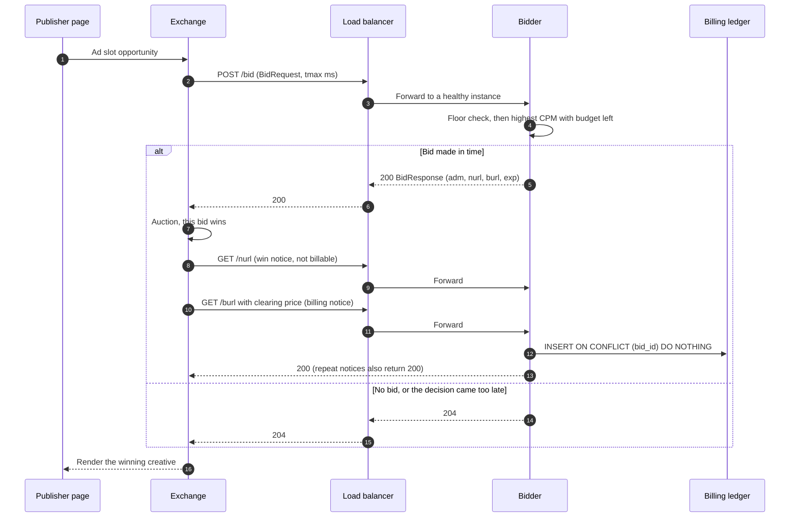
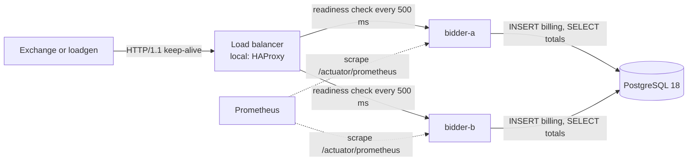
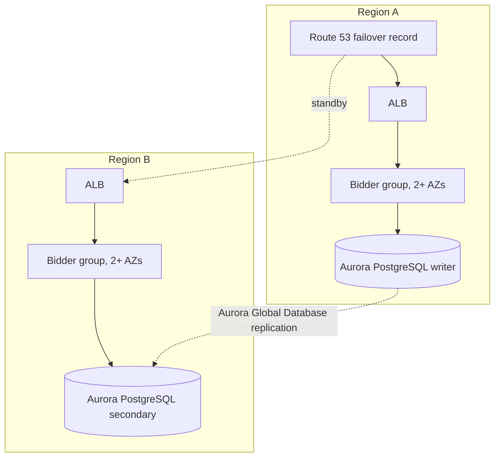

# OpenRTB HA POC

A proof of concept for a real-time bidder built against the IAB OpenRTB 2.6 spec. It answers bid
requests in protobuf or JSON, bills idempotently, and keeps serving when one instance crashes.

Stack: Java 26 · Spring Boot 4.1.1 · OpenRTB 2.6 (IAB tag `2.6-202606`) · PostgreSQL 18 ·
HAProxy 2.8 · Docker Compose.

Everything runs on one machine with Docker Compose. Nothing is deployed to AWS. The AWS layout in
the architecture section is a target design, not a built system.

## What it shows

- **Business flow.** A bid, then a win notice (`nurl`), then a billing notice (`burl`). Billing is
  idempotent on the bid id, so a retried notice is never a second charge.
- **High availability.** Two bidders behind HAProxy. Connection-failure retries cover the window
  before the health check removes a crashed instance. Under a SIGKILL at 300 rps, clients saw 0 to 2
  errors out of 18,000 requests per run.
- **Performance.** Protobuf against JSON on server CPU and payload size. A change to how budget
  totals are kept cut PostgreSQL CPU per served request by about two-thirds.
- **Measurement.** A fixed-rate load generator that measures latency from the scheduled send time,
  so a stalled server cannot hide its own stalls. Billing is reconciled against the ledger after
  every failover run.

## Architecture

### Business flow

An ad slot on a publisher page is sold in a real-time auction. The exchange sends each bidder a
`BidRequest`. The bidder answers within the deadline (`tmax`) with a bid or a no-bid. The exchange
then sends the winner notices.



Rules the code enforces:

- **Billing is the burl, not the nurl.** The nurl only confirms a win. The burl carries the billable
  clearing price. The exchange is expected to retry it until it gets an acknowledgement.
- **Retries are safe.** `bid_id` is the primary key, so a repeated burl adds no row. It still returns
  200, so the exchange stops retrying.
- **A late answer is a lost answer.** The exchange stops waiting at `tmax`. The bidder drops any
  decision that finishes after its own budget (`tmax` minus a safety margin) and answers 204.

### HA topology (local, built and measured)



### Target AWS layout (not built, not applied)



### Components

| Component | Path | Responsibility |
|---|---|---|
| OpenRTB protobuf bindings | `openrtb-proto/` | Generated from the vendored IAB `openrtb.proto` (2.6-202606) by the official `protoc` from Maven Central. |
| Bidder service | `bidder/` | Bid decision, notices, budget view, ledger, metrics, health. |
| Load generator | `loadgen/` | Fixed-rate sender. Measures latency from the scheduled send time. |
| HA simulation | `cases/openrtb-ha/` | Compose stack (PostgreSQL, two bidders, HAProxy), failover drill, benchmark matrix. |
| Analysis | `scripts/analyze.py` | Turns loadgen reports into tables, recovery times and billing reconciliation. |

### Bidder internals

| Class | Role |
|---|---|
| `api/BidController` | `POST /bid` in protobuf or JSON. Applies the deadline check. |
| `api/NoticeController` | `GET /burl` (billing, idempotent) and `GET /nurl` (informational). |
| `domain/BidEngine` | Chooses the impression's campaign. Pure logic, no I/O. |
| `domain/DeadlineBudget` | Converts `tmax` into the time this bidder may spend. |
| `budget/BudgetCache` | In-memory remaining budget per campaign, in micro-USD. Read on the bid path. |
| `ledger/BudgetSync` | Reloads per-campaign totals from `campaign_totals` on a schedule. Keeps the last good view on failure. |
| `ledger/BillingService` | Settles one burl: insert first, then lower the local view. |
| `ledger/BillingLedger` | The idempotent insert and the per-campaign totals query. |
| `metrics/BidMetrics` | Counters and the bid latency histogram. |

## Proof of run

Every number below comes from the raw reports in [docs/benchmarks/raw/](docs/benchmarks/raw/). The
method, per-run data and discarded runs are in [docs/benchmarks.md](docs/benchmarks.md).

The whole stack ran on one shared 2-vCPU host. The bidders, PostgreSQL, HAProxy and the load
generator all competed for those two CPUs. The numbers compare configurations with each other. They
are not production capacity.

### 1. Protobuf against JSON

Four alternating pairs at 300 rps, 30 s measured each. Medians, with the observed range in brackets.

| Metric | Protobuf | JSON | Difference |
|---|---|---|---|
| Request body | 302 B | 438 B | −31% |
| Bid response body | 680 B | 990 B | −31% |
| Server CPU per served request | 560 µs (556–607) | 682 µs (672–982) | −18%, ranges do not overlap |
| p50 latency | 1.47 ms (1.38–1.52) | 1.71 ms (1.56–1.74) | −14%, ranges do not overlap |
| p99 latency | 9.2 ms (8.4–16.1) | 11.6 ms (9.8–17.7) | ranges overlap, no difference shown |

The JSON figures are an upper bound. `JsonFormat` in protobuf-java-util 4.35.1 escapes `=`, `&`, `<`,
`>` and `'` as `\u00xx`, and this version has no switch to turn that off.

### 2. Keep-alive against a new connection per request

Two runs each at 100 rps, on loopback.

| Metric | Keep-alive | New connection per request |
|---|---|---|
| Server CPU per served request | 757 µs (744–771) | 767 µs (762–772), no difference shown |
| p50 latency | 2.09 ms (2.08–2.10) | 3.94 ms (3.93–3.94) |
| p99 latency | 7.2 ms | 17.3 ms |

The server does about the same work either way. The extra latency sits on the client, because the
cold client builds a new `HttpClient` for every request. Loopback has almost no connection setup
cost, so this run says nothing about the cost of a WAN connection or TLS.

### 3. Billing totals: ledger scan against incremental totals

Two runs each at 300 rps, using the same runner (`scripts/db-cpu-run.sh`).

| Metric | Ledger scan (before) | Incremental totals (after) |
|---|---|---|
| PostgreSQL CPU per served request | 574 µs and 620 µs | 203 µs and 205 µs |
| PostgreSQL CPU reduction | | about 66% |
| p99 latency | 54 ms and 50 ms | 33 ms and 11 ms |

Correctness checks for the incremental version: a first billing notice raises the total by exactly
its spend, a duplicate notice changes nothing, the per-campaign totals equal `SUM(spend_micros)` over
the ledger, and the one-time backfill gives exact totals.

The CPU reduction is the reliable result. The p99 change is suggestive only. Two runs per side are
not enough to claim it.

### 4. Failover: SIGKILL one bidder under load

300 rps, 60 s measured after a 10 s warm-up. `bidder-a` is killed at second 20 and restarted at
second 40. Totals are over 18,000 requests per run.

| Run | Client errors | Late (past 100 ms) | Recovery (under 1% bad) | Billing reconciliation |
|---|---|---|---|---|
| Before slow-start, run 1 | 2 | 296 | 1.86 s | MATCH (8,764) |
| Before slow-start, run 2 | 2 | 293 | 2.85 s | MATCH (8,752) |
| With slow-start, run 1 | 2 | 265 | 2.01 s | MATCH (8,689) |
| With slow-start, run 2 | 0 | 282 | 1.90 s | MATCH (8,638) |

- Client errors fall in the kill second. HAProxy's connection-failure retry covers the window before
  the health check notices the dead instance.
- About 300 late responses per run fall around the kill. The timing fits HAProxy's 300 ms connect
  timeout. That is an inference, not yet confirmed by per-request logs.
- `slowstart 30s` cut the unhealthy window after restart from 2 to 3 s to about 1 s per run. The
  late-count difference is within run-to-run noise, and two runs per side are too few to claim it.
- The slow-start runs show a pre-kill unhealthy fraction of 0.37 to 0.42%. The pre-kill runs showed
  0.00% and 0.04%. This is not explained yet.

### 5. Billing reconciliation

- In each failover run, the ledger rows written during the run equal the distinct bids billed by the
  load generator. A bid billed twice still counts once.
- Duplicate notices, about 5% of each run, all return 200 and add no rows.
- The runs above had no failed notices, so the retry path was not exercised by a failure. Earlier
  superseded runs did show failed notices that the database had committed, even after retries. The
  cause is not classified. See [section 5 of the benchmarks](docs/benchmarks.md#5-results-that-were-discarded-and-why).

### What the proof does not show

- Production capacity or latency, or behaviour on other hardware.
- Multi-AZ or multi-region failover. Both bidder instances run on one host.
- The cost of a WAN connection setup, or of TLS.
- A database outage, or a graceful shutdown under load.
- Virtual threads on their own. They are enabled but not benchmarked separately.
- Why some billing notices fail and are still committed.

## Google RTB guidance used

Source pages: the Authorized Buyers RTB peer guide and start page. The table lists only what those
pages state, and how this POC uses each point.

| Topic | Google's statement | In this POC |
|---|---|---|
| Deadline | The deadline is `BidRequest.tmax`. Google waits 80 to 1000 ms, depending on format and auction type. | `DeadlineBudget` reads `tmax`, clamps it to a maximum and subtracts a 10 ms margin. |
| Target | 85% of responses must arrive within the deadline. Bidders that cannot achieve this consistently are throttled. | The loadgen reports late responses separately from errors. |
| Headroom | Target a total time well below the deadline. | Default `tmax` is 100 ms. |
| Locations | Four trading locations: NA East, NA West, Europe, APAC. | Not implemented. One region only. |
| Format | JSON and Protobuf are both supported. The start page recommends neither. | Both are accepted. The codec benchmark measures the difference. |

Google's pages do not say that protobuf is faster than JSON, and they do not discuss keep-alive. The
results for both are measured here, not borrowed from Google.

## Layout

| Path | Contents |
|---|---|
| `proto/` | Vendored IAB `openrtb.proto`, 2.6-202606. The sha256 is in [docs/design-decisions.md](docs/design-decisions.md). |
| `openrtb-proto/` | Generates Java from the vendored proto with the official `protoc` from Maven Central. |
| `bidder/` | The bidder service. The class table is above, and in [docs/architecture.md](docs/architecture.md). |
| `loadgen/` | Fixed-rate load generator, with JSON reports. |
| `cases/openrtb-ha/` | Compose stack, HAProxy config, failover drill, benchmark matrix. |
| `scripts/analyze.py` | Turns reports into tables and failover summaries. Standard library only. |
| `docs/architecture.md` | Diagrams and component detail. |
| `docs/design-decisions.md` | Each decision with its reason, the alternatives, and the evidence. Also the verified Google RTB constraints and the known gaps. |
| `docs/benchmarks.md` | Results, method, discarded runs, and caveats. |
| `docs/benchmarks/raw/` | Raw reports from every run that the write-up cites. |

## Requirements

- JDK 21 and Maven.
- Docker Engine with Compose. Tested with Docker Engine 29.8.2 and Compose v5.
- Python 3.10 or newer. Analysis uses the standard library only.
- Tested on a 2-vCPU Linux VM. Absolute numbers from other hardware are not comparable.

## Run it

```bash
# 1. Build everything and run the unit tests (downloads protoc on first run)
gradle -p . test

# 2. Start PostgreSQL, two bidders and HAProxy
docker compose up -d --build

# 3. Failover drill: crash bidder-a under load, restart it, reconcile billing (about 2.5 min)
scripts/failover-drill.sh
python3 scripts/analyze.py failover docs/benchmarks/raw/failover-<timestamp>

# 4. Benchmark matrix: codec and connection reuse (about 10 min)
scripts/run-benchmarks.sh
python3 scripts/analyze.py table docs/benchmarks/raw/codec-*/report.json docs/benchmarks/raw/conn-*/report.json

# 5. Tear down, including the database volume
docker compose down -v
```

Ports: the load balancer is on `8088`, the HAProxy stats page on `8404`, and the bidders directly on
`8081` and `8082`. PostgreSQL is on `5432`.

## Known limits

The main ones are listed here. The full list, with reasons, is in
[docs/design-decisions.md](docs/design-decisions.md#known-gaps-must-be-fixed-before-any-production-use).

- **Billing notices are not verified against issued bids.** Anyone who can reach `/burl` can create
  billing rows. Production needs signed bid tokens.
- **`bid.exp` is not enforced** on notices.
- **One region, one host.** The four Google trading locations are not covered. Local latency numbers
  are not production numbers.
- **No database-outage test.** The fail-open and fail-closed behaviour is designed but not measured.
- **Failed billing notices can still be committed.** In some superseded runs, notices failed even
  after retries, yet the ledger recorded them. The cause is not classified. See
  [docs/benchmarks.md](docs/benchmarks.md#5-results-that-were-discarded-and-why).
- **No AWS resources.** Terraform for Aurora Global, Route 53 and ALB is not written and was not applied.

## Status

Verified by running it:

- The bid, win-notice and billing-notice path, including idempotent billing and price capping.
- Protobuf and JSON encodings.
- The failover drill, with billing reconciliation after each run.
- The benchmark matrix and the database before/after comparison.

Not yet verified: a database outage, graceful shutdown under load, the virtual-thread setting on its
own, and TLS.
