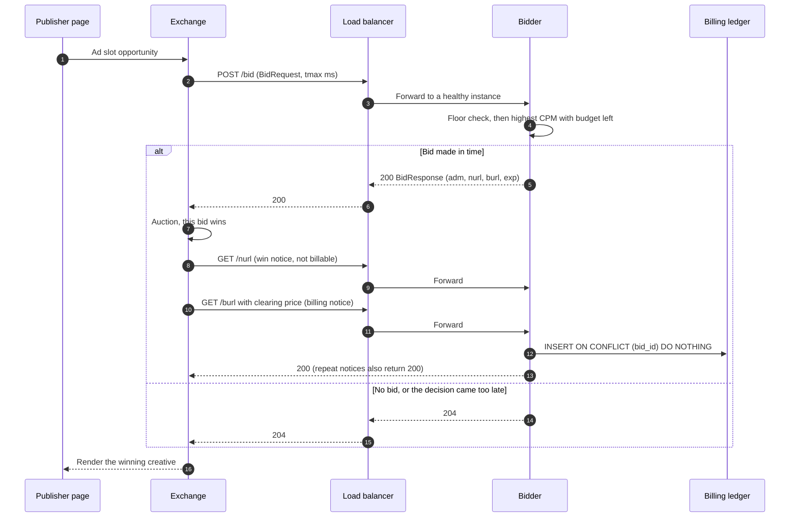
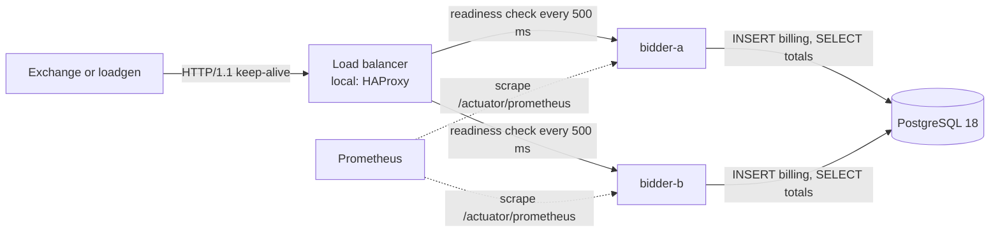
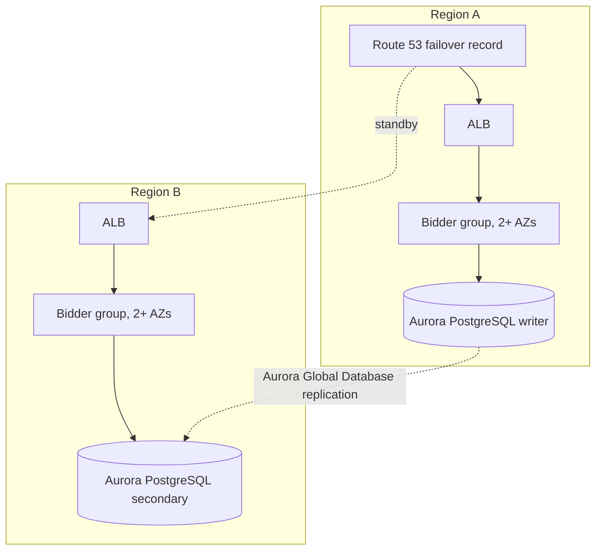

# Architecture

This POC is one bidder service in an OpenRTB 2.6 real-time bidding (RTB) flow. It covers the
bid path, the notice path, the billing ledger, and the high-availability (HA) layout around them.

## 1. Business flow

An ad slot on a publisher page is sold in a real-time auction. The exchange sends each bidder a
`BidRequest`. Each bidder answers within the deadline (`tmax`) with a bid or with no-bid. The
exchange then sends the winner notices.

Notes that the code enforces:

- **Billing is the burl, not the nurl.** The nurl only confirms a win. The burl carries the
  billable clearing price, and the exchange retries it until it gets an acknowledgement.
- **Retries are safe.** `bid_id` is the primary key, so a repeated burl is a no-op. It still
  returns 200, so the exchange stops retrying.
- **A late answer is a lost answer.** The exchange stops waiting at `tmax`. The bidder drops any
  decision that finishes after its own budget (`tmax` minus a safety margin) and answers 204.

## 2. HA topology

What runs locally (Docker Compose) and what the AWS target would look like are shown separately.
Only the local version has been built and measured.

Target design on AWS (not built, not applied):

## 3. Components

| Component | Path | Responsibility |
|---|---|---|
| OpenRTB protobuf bindings | `openrtb-proto/` | Generated from the vendored IAB `openrtb.proto` (2.6-202606) by the official `protoc` from Maven Central. |
| Bidder service | `bidder/` | Bid decision, notices, budget view, ledger, metrics, health. |
| Load generator | `loadgen/` | Fixed-rate sender. Measures latency from the scheduled send time. |
| HA simulation | `cases/openrtb-ha/` | Compose stack (PostgreSQL, two bidders, HAProxy), failover drill, benchmark matrix. |
| Analysis | `scripts/analyze.py` | Turns loadgen reports into tables, RTO and billing reconciliation. |

## 4. Bidder internals

| Class | Role |
|---|---|
| `api/BidController` | `POST /bid` in protobuf or JSON. Applies the deadline check. |
| `api/NoticeController` | `GET /burl` (billing, idempotent) and `GET /nurl` (informational). |
| `domain/BidEngine` | Chooses the impression's campaign. Pure logic, no I/O. |
| `domain/DeadlineBudget` | Converts `tmax` into the time this bidder may spend. |
| `budget/BudgetCache` | In-memory remaining budget per campaign, in micro-USD. Read on the bid path. |
| `ledger/BudgetSync` | Reloads per-campaign totals from `campaign_totals` on a schedule. Keeps the last good view on failure. |
| `ledger/BillingService` | Settles one burl: insert first, then lower the local view. |
| `ledger/BillingLedger` | The idempotent insert and the per-campaign totals query. |
| `metrics/BidMetrics` | Counters and the bid latency histogram. |
